# 🔌 AXI4-Lite I2C Master IP — MicroBlaze SoC Integration & UVM Verification

[-purple.svg)]()
[-orange.svg)]()

> **I2C Master를 AMBA AXI4-Lite 슬레이브 IP로 패키징해 MicroBlaze SoC에 통합하고, UVM으로 검증한 프로젝트**
> 기존 APB 기반 I2C 설계를 AXI 버스로 확장하여 AXI Master/Slave 핸드셰이크 FSM 설계, Vivado IP 통합, UVM 검증, FPGA 보드 구동까지 수행했습니다.

---

## 📋 Table of Contents
1. [Project Overview](#-project-overview)
2. [Background: I2C, AXI](#-background-i2c-axi)
3. [System Architecture](#-system-architecture)
4. [UVM Verification](#-uvm-verification)
5. [FPGA Implementation](#-fpga-implementation)
6. [Troubleshooting](#-troubleshooting)
7. [Lessons Learned](#-lessons-learned)

---

## 📌 Project Overview

* **목표**: I2C Master를 AXI4-Lite 슬레이브 IP로 만들고, MicroBlaze 소프트웨어(C)에서 레지스터 맵을 통해 제어하며 UVM으로 검증하는 SoC 구성.
* **팀**: 2인 (강혜빈, 윤정원)
* **구성 요소**

| 구분 | 역할 | 사용 IP |
| :--- | :--- | :--- |
| **I2C** | I2C Master (`SCL`, `SDA`) | `I2C1.0.v` (패키징 IP) |
| **GPIO** | LED / Switch 제어 | `GPIO1.0.v` (패키징 IP) |
| **FND** | 7-Segment로 데이터 표시 | `FND1.0.v` (패키징 IP) |
| **UART** | PC ↔ FPGA 메시지, 로그 출력 | `axi_uartlite` |

---

## 📚 Background: I2C, AXI

### I2C

* 두 가닥의 선(`SDA`, `SCL`)만으로 마스터와 여러 슬레이브(1:N)를 연결하는 직렬 통신 프로토콜.
* **Open-drain** 구조: 신호 유지를 위해 외부 풀업 저항이 필요하고, 데이터선이 하나이므로 한 번에 한 방향만 통신하는 **반이중(Half-Duplex)** 방식.
* SPI에 비해 속도는 느리지만 하드웨어 구성이 간단해 칩 설계 비용이 낮음.

### AXI (AMBA AXI4)

| 특징 | 설명 |
| :--- | :--- |
| 모듈형 IP 통합 | 표준화된 AXI 인터페이스를 사용해 IP를 플랫폼에 통합 |
| 병렬 처리 | **5개의 독립 채널** 활용 |
| 통신 효율 | **READ / WRITE 채널 분리** |
| 핸드셰이크 | `VALID` / `READY` 프로토콜 |

| Channel | 방향 | 설명 |
| :--- | :--- | :--- |
| **Write Address (AW)** | Master → Slave | 쓸 주소와 제어 정보 전송 |
| **Write Data (W)** | Master → Slave | 기록할 데이터 전송 |
| **Write Response (B)** | Slave → Master | 데이터 수신 및 쓰기 완료 후 성공 여부 전달 |
| **Read Address (AR)** | Master → Slave | 읽어올 주소와 제어 정보 전송 |
| **Read Data (R)** | Slave → Master | 요청받은 주소에서 읽은 데이터를 Master로 전송 |

**VALID & READY 핸드셰이크**의 장점

* 두 신호가 모두 1일 때만 데이터가 전달되므로 **데이터 유실이 없음**.
* 장치 간 속도 차이가 있어도 오류 없이 통신 가능.
* 서로의 신호를 확인하고 진행하므로 **Deadlock 방지**.

  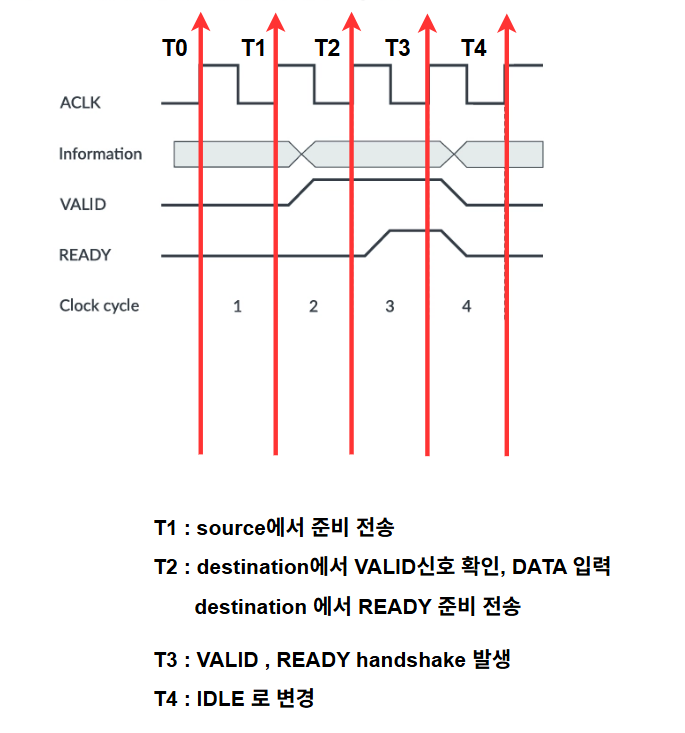

| 시점 | 동작 |
| :---: | :--- |
| T0 | 시스템 초기 상태 |
| T1 | Source 준비 및 전송 시작 (`VALID` 상승) |
| T2 | Destination이 신호를 인지하고 `READY` 준비 |
| T3 | **Handshake 발생** (데이터 전송 완료) |
| T4 | 전송 종료 및 `IDLE` 복귀 |

---

## 🧩 System Architecture

### 1. AXI4-Lite Master / Slave FSM

CPU 측 사용자 인터페이스(`transfer`, `ready`, `addr`, `wdata`, `write`, `rdata`)를 AXI4-Lite 채널 신호로 변환하는 **Master**와 레지스터 블록을 가진 **Slave**를 FSM으로 설계했습니다. Write(AW → W → B)와 Read(AR → R) 트랜잭션을 각각 독립된 상태 머신으로 구성했습니다.

  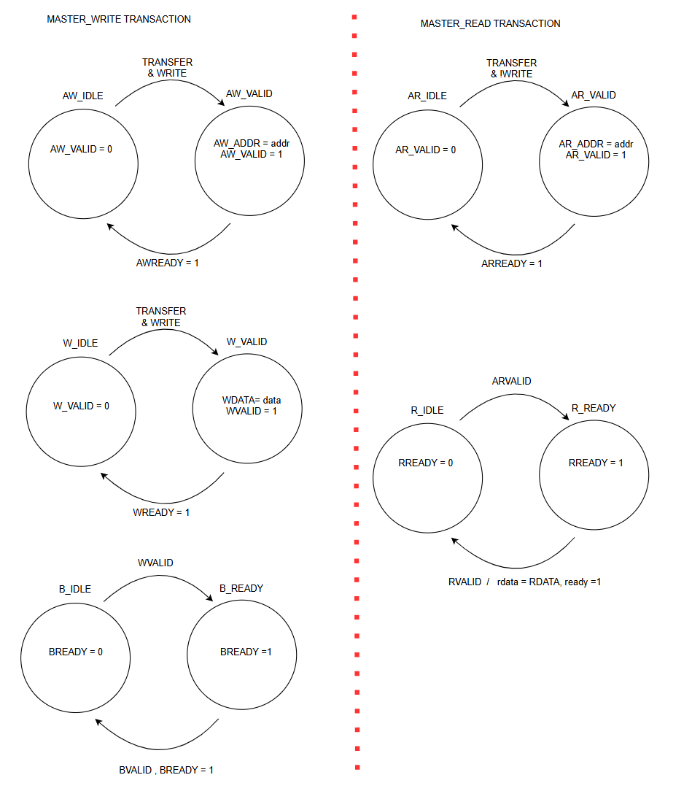

  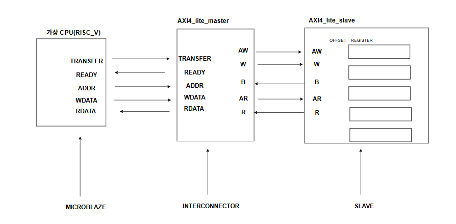
  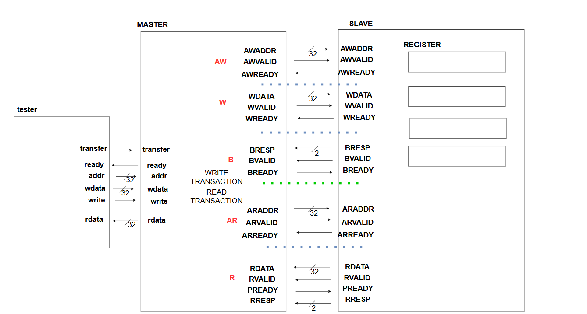

### 2. SoC Block Diagram

MicroBlaze가 AXI Interconnect를 통해 각 주변장치를 제어합니다.

  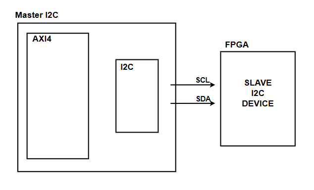

UART IP는 상태(`UART_S`), 송신(`UART_T`), 수신(`UART_R`), 제어(`UART_C`, 수신 인터럽트 enable) 레지스터를 가지며, 수신 시 `rx_intr`로 인터럽트를 발생시킵니다.

  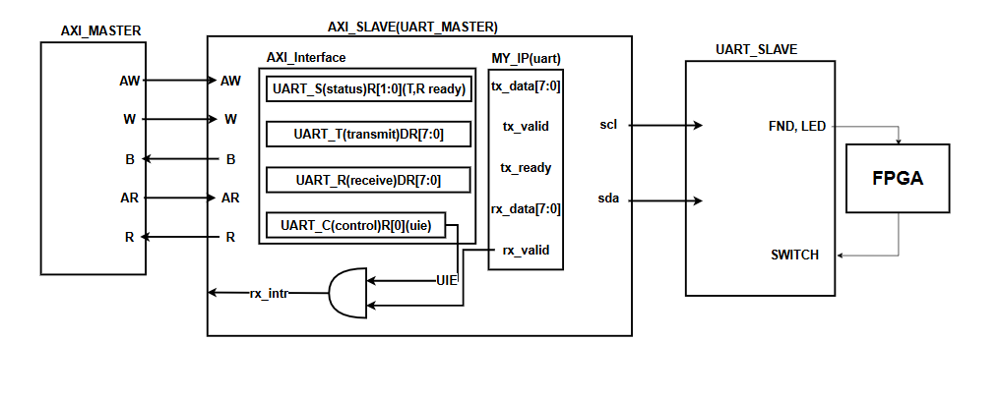

### 3. Memory Map (Memory-Mapped I/O)

주변장치는 `0x44A0_0000`부터 `64 KB` 간격으로 배치됩니다.

| 주소 | 장치 |
| :---: | :---: |
| `0x44A0_0000` | I2C |
| `0x44A1_0000` | GPIO0 |
| `0x44A2_0000` | GPIO1 |
| `0x44A3_0000` | GPIO2 |
| `0x44A4_0000` | GPIO3 |

  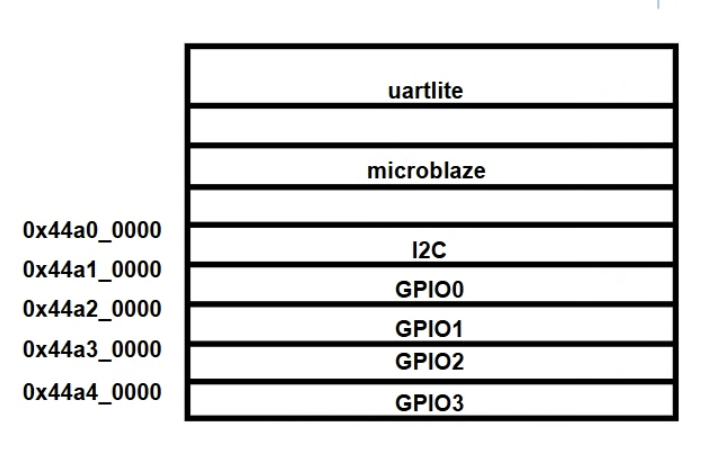

### 4. Software Layered Architecture

하위 모듈을 세분화한 계층 구조로 MicroBlaze 소프트웨어를 구성했습니다.

  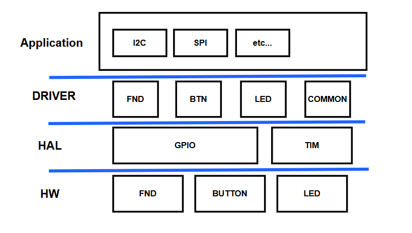

| Layer | 구성 |
| :--- | :--- |
| **Application** | I2C, SPI 등 |
| **Driver** | FND, BTN, LED, COMMON |
| **HAL** | GPIO, TIM |
| **HW** | FND, BUTTON, LED |

---

## 🧪 UVM Verification

I2C AXI 슬레이브 IP를 대상으로 UVM 환경(Driver · Monitor · Sequencer · Scoreboard · Coverage)을 구성해 AXI Write/Read 트랜잭션을 검증했습니다.

* **Tools**: Synopsys VCS W-2024.09-SP1, UVM-1.2
* **Driver**: AXI 모드로 Write/Read 트랜잭션 인가
* **Monitor**: AXI 버스를 모니터링해 Write/Read 캡처
* **Scoreboard**: Write 시 메모리 모델 업데이트, Read 시 기대값과 실제값 비교
* **Coverage**: Address / Direction / Data / Cross(Address × Direction)

| 테스트 | Transaction 수 | Scoreboard | Overall | Address | Direction | Data | Cross (Addr × Dir) |
| :--- | :---: | :---: | :---: | :---: | :---: | :---: | :---: |
| **Directed** | 2 | **PASS** (Errors 0) | 41.7% | 33.3% | 100.0% | 0.0% | 33.3% |
| **Random** | 50 | **PASS** (Errors 0) | 70.8% | 66.7% | 100.0% | 50.0% | 66.7% |

### Directed Test
`i2c_directed_seq`: 주소 `0x0`에 데이터 `0x3`을 Write한 뒤 Read하여 기대값(`0x3`)과 실제값이 일치함을 확인.

  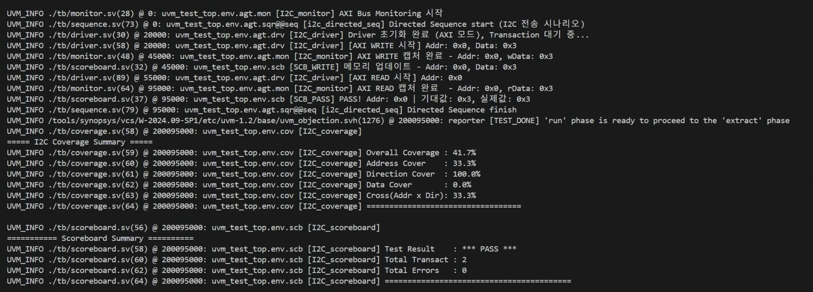

  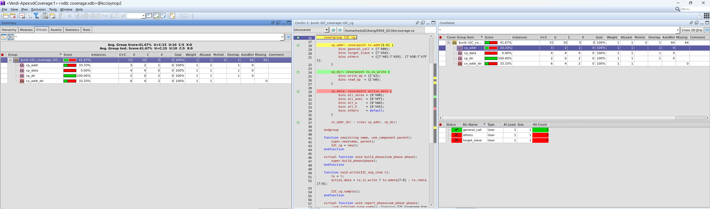

### Random Test
임의의 주소(`0x0`, `0x4`, `0x8`, `0xC`)와 데이터로 Write/Read를 반복하고 매 Read마다 Scoreboard가 기대값을 비교.

  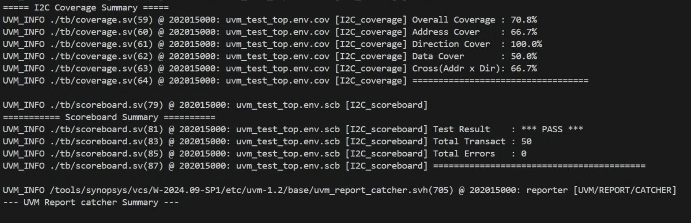

  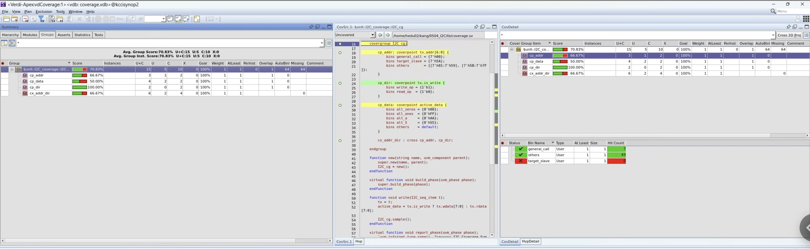

<b>Random Test 전체 로그 보기</b>

  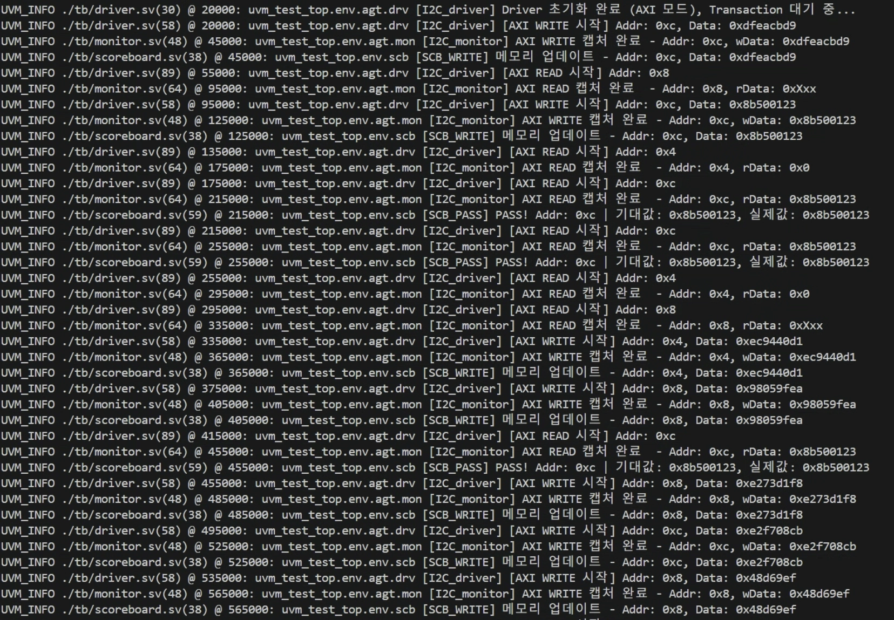

---

## 🎬 FPGA Implementation

### I2C — AXI + UART Log

* 스위치 값을 읽어 FND와 LED에 Write하고, UART를 통해 PC로 로그를 출력.

  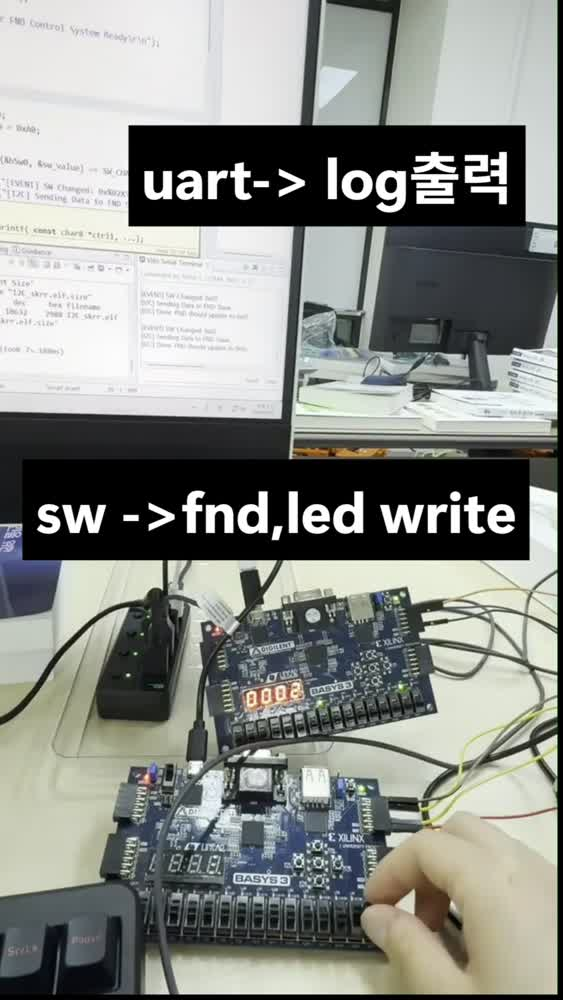

> ▶ **[I2C 구현 영상 보기](docs/implementation_i2c.mp4)**

---

## 🔧 Troubleshooting

| # | 문제 현상 (Issue) | 원인 및 해결 |
| --- | --- | --- |
| **1** | **`edge_detector` 오류** | _(원인 및 해결 과정을 직접 작성해 주세요)_ |
| **2** | **Slave timing 오류** | _(원인 및 해결 과정을 직접 작성해 주세요)_ |

---

## 💡 Lessons Learned

* UVM은 class 개념과 Synopsys 툴이 낯설었지만, 반복하면서 환경 구조(agent, scoreboard, coverage)를 이해하게 되었습니다.
* APB에서 AXI로 넘어가면서 신호 수와 고려할 사항(채널 분리, 핸드셰이크)이 크게 늘었습니다.
* 소프트웨어(MicroBlaze C)를 통한 동작 확인이 가장 어려웠고, C/Python 학습을 통해 보완할 계획입니다.

---

## 👨‍💻 Author

- **GitHub**: [@ethan000106](https://github.com/ethan000106)
