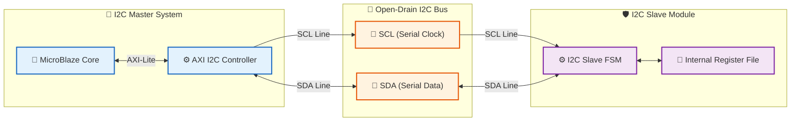

<div align="center">

# 🤝 MicroBlaze & FPGA I2C Master-Slave System


**MicroBlaze 임베디드 코어(Master)와 Custom FPGA Logic(Slave) 간의<br>I2C 프로토콜 통신 시스템 설계 및 통합 검증 프로젝트**

</div>

---

## ✨ Key Features

| 항목 (Feature) | 설명 (Description) |
| :--- | :--- |
| 👑 **I2C Master System** | MicroBlaze 임베디드 프로세서 및 AXI I2C Controller 기반의 Master 하드웨어 시스템 |
| 🛡️ **Custom I2C Slave** | Start/Stop 조건 감지, 7-bit 주소 매칭, R/W 제어 및 ACK/NACK 응답 지원 Custom Slave RTL |
| 🚌 **Bidirectional Bus Control** | Inout 포트 기반의 Open-Drain SDA/SCL 양방향 버스 인터페이스 제어 |
| 🔍 **Full-Duplex Verification** | Master와 Slave 간 데이터 송수신 동작 검증을 위한 통합 Testbench 제공 |

---

## 📊 System Architecture & Block Diagram



---

## 📂 Directory Structure

```text
📦 I2C_System
 ┣ 📂 rtl
 ┃ ┣ 📂 master           # MicroBlaze & AXI I2C Master RTL 소스코드
 ┃ ┗ 📂 slave            # Custom I2C Slave RTL 모듈 (FSM & Control)
 ┣ 📂 tb                 # Master-Slave 통합 시뮬레이션 Testbench
 ┣ 📂 docs               # 시스템 아키텍처 & 타이밍 다이어그램 문서
 ┣ 📂 sim                # 시뮬레이션 결과 및 웨이브폼 로그 (Git-ignored)
 ┗ 📜 .gitignore         # Vivado 임시/빌드 정크 파일 필터
```

---

## 🛠️ Simulation & Verification Guide

### AMD Xilinx Vivado (XSIM)
```bash
# 1. RTL 및 Testbench 소스 컴파일
xvlog -sv rtl/master/*.sv rtl/slave/*.sv tb/*.sv

# 2. 엘라보레이션 및 시뮬레이션 실행
xelab tb_i2c_top -s tb_i2c_top_sim -debug typical
xsim tb_i2c_top_sim -gui
```

---

## 👨‍💻 Author

- **GitHub**: [@ethan000106](https://github.com/ethan000106)
- **License**: MIT License
```


